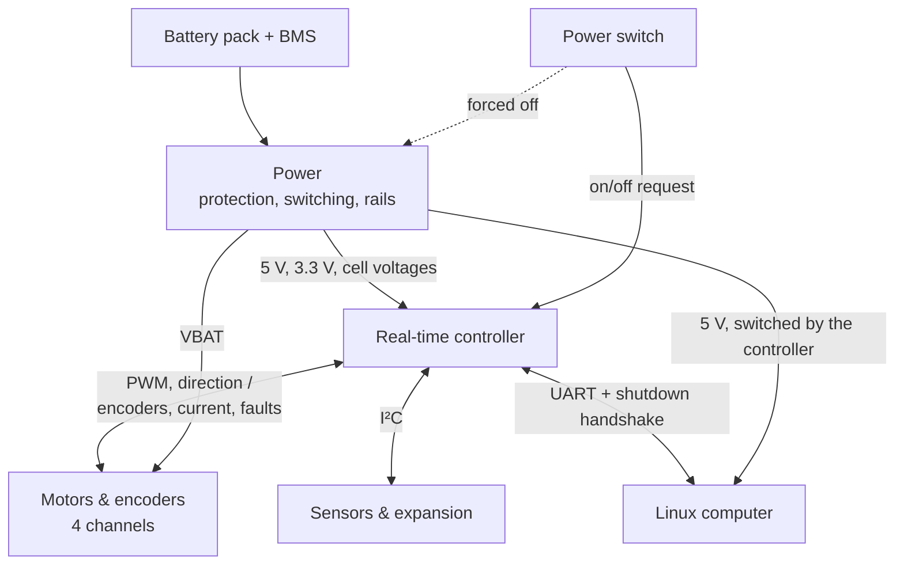
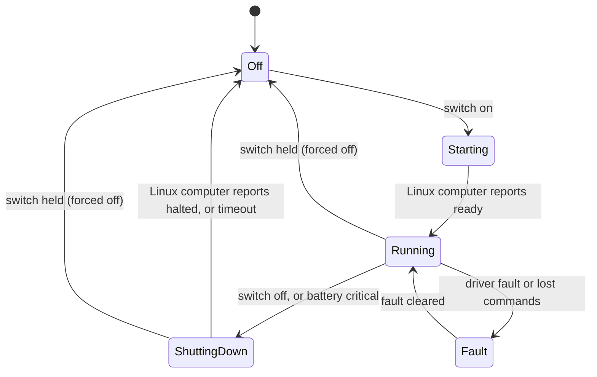

# Robot-Platform Architecture

**Document revision 0.2 (draft), 20 Nov 2026**
*Copyright (C) 2026 Christopher Keller*

---

## Table of Contents

- [1. Scope](#1-scope)
  - [1.1 Identification](#11-identification)
  - [1.2 Background](#12-background)
  - [1.3 Objective](#13-objective)
  - [1.4 Definitions and Acronyms](#14-definitions-and-acronyms)
- [2. System Overview](#2-system-overview)
  - [2.1 Power](#21-power)
  - [2.2 Real-time Controller](#22-real-time-controller)
  - [2.3 Linux Computer](#23-linux-computer)
  - [2.4 Motors and Encoders](#24-motors-and-encoders)
  - [2.5 Sensors and Expansion](#25-sensors-and-expansion)
  - [2.6 Chassis and Mechanics](#26-chassis-and-mechanics)
- [3. Interfaces](#3-interfaces)
- [4. Operating States and Power Sequencing](#4-operating-states-and-power-sequencing)
- [5. Fault Handling](#5-fault-handling)
- [6. Requirements Allocation](#6-requirements-allocation)
- [7. Open Questions](#7-open-questions)
- [8. Revision History](#8-revision-history)

## 1. Scope
---
### 1.1 Identification

| Item | Value |
|---|---|
| System | Robot-Platform: a small four-wheel indoor robot that drives itself, built around a custom main board and a Raspberry Pi 5 running a custom Yocto Linux image |
| Hardware | Main board, Rev A (in design) |
| Document | Architecture description, revision 0.2 (draft) |
| Repository | github.com/cpkeller25/robot-platform |
| Requirements | [requirements.md](requirements.md) |
| Author | Christopher Keller |

### 1.2 Background

Robot-Platform is a personal project with two goals: a working robot that can
serve as a base for future robotics projects, and a vehicle for building skills
in PCB design, embedded firmware and embedded Linux. Where a design choice
trades ease against learning, this project leans toward learning, as long as
the robot still meets its requirements.

### 1.3 Objective

The purpose of this document is to describe the architecture of the Robot-Platform:
the major blocks (power system, real-time controller, Linux computer, motors and
encoders, sensors, and chassis), what each one is responsible for, how they connect,
and which requirements in [requirements.md](requirements.md) each one satisfies.

It describes *what* each block does and *how the blocks talk to each other*. The
detailed design of each block (part choices, schematics, firmware) is documented
separately as it is developed. Where a part is named here, it is the current
choice and may change during part selection.

### 1.4 Definitions and Acronyms

| Term / Acronym | Definition |
|---|---|
| ADC | Analog-to-digital converter: measures a voltage |
| BMS | Battery management system: protects lithium cells from over-charge, over-discharge and over-current |
| Encoder | Sensor on each motor shaft that produces pulses as the wheel turns, giving speed and direction |
| GPIO | General-purpose input/output pin |
| I²C | Two-wire bus shared by several low-speed devices, each with its own address |
| IMU | Inertial measurement unit: gyroscope + accelerometer (+ sometimes magnetometer) |
| Load switch | An electronically controlled switch that turns a supply rail on or off |
| MCU | Microcontroller: runs one program with no operating system |
| PWM | Pulse-width modulation: switching on and off quickly to set an average power |
| Real-time | Guaranteed to respond within a fixed, short time, every time |
| UART | Two-wire serial link between two devices (TX and RX) |
| VBAT | The battery voltage rail after protection: 9.0 to 12.6 V |
| Watchdog | A timer that triggers a safe action if something stops responding |
| Yocto | A set of tools for building a custom Linux distribution from source |

---

## 2. System Overview
---
The robot runs on a single battery pack that powers the motors, the real-time
controller, the Linux computer and all sensors.

The design is split between two computers, each doing what it is good at:

- **The real-time controller** (a microcontroller on the main board) owns
  everything that must happen on time, every time: motor control, encoder
  counting, battery monitoring, and power-on and power-off sequencing. On its
  own it is a complete, drivable robot.
- **The Linux computer** decides what the robot should do and tells the
  controller in high-level terms ("drive at 0.3 m/s, turning 20° per second").
  It never drives a motor directly.

This split means a slow or crashed Linux program can never leave a motor
running, and the controller's timing never depends on what Linux is doing.

*The dotted line works with no software running. The laptop connections (Wi-Fi,
USB-C, SSH) are listed in the interfaces table.*

### 2.1 Power

**Responsibilities**

- Accept the battery and protect everything downstream from a short circuit,
  a reversed battery and voltage spikes.
- Switch the robot on and off.
- Produce the supply rails: VBAT for the motors, 5 V and 3.3 V for the
  electronics, and a separate switched 5 V supply for the Linux computer.
- Measure each cell's voltage so the controller can warn and shut down.
- Provide a hard power-off path that works even if all software has crashed.

**Current choice:** 3 removable 18650 cells in series (3S) with an off-board BMS;
fuse, reverse-polarity protection and a TVS on the main board; a buck converter
to 5 V / 3 A; an LDO to 3.3 V; a second 5 V / 5 A supply for the Linux computer.

**Satisfies:** R5, R8, R11, R12, R13, R19

### 2.2 Real-time Controller

**Responsibilities**

- Run each wheel's closed-loop speed control at 100 Hz or faster.
- Count all encoder pulses in hardware, so none are missed.
- Receive drive commands from the Linux computer and send back telemetry
  (wheel speeds, battery state, faults).
- Stop the motors if commands stop arriving (command watchdog).
- Read the power switch and run the power-on and power-off sequences,
  including the Linux computer's clean shutdown.
- Monitor cell voltages, motor currents and driver faults.
- Offer Wi-Fi for monitoring and tuning, so the robot can be tuned even
  before the Linux computer is working.

**Current choice:** ESP32-S3-WROOM-1-N8 (or -N8R2) module on the main board.

**Satisfies:** R3, R6, R9, R12, R19

### 2.3 Linux Computer

**Responsibilities**

- Run the custom Linux image built with Yocto.
- Run the high-level robot program and send it to the controller as drive
  commands.
- Shut down cleanly when the controller asks, and signal when it has halted.
- Survive an unexpected power loss without corrupting its storage (read-only
  root filesystem).
- Provide room for future camera, vision and mapping work.

**Current choice:** Raspberry Pi 5 (decided), mounted on its own deck and
connected to the main board through its 40-pin header.

**Satisfies:** R7, R8, R9, R18

### 2.4 Motors and Encoders

**Responsibilities**

- Drive four wheels independently (skid steering).
- Report each wheel's rotation through a quadrature encoder.
- Report each motor's current, and limit it, so a stall can be detected and
  survived.

**Current choice:** 4 × Pololu 34:1 25D 12 V gearmotors with 48 CPR encoders;
one DRV8876 driver per motor on the main board.

**Satisfies:** R3, R4, R6, R11

### 2.5 Sensors and Expansion

**Responsibilities**

- Provide the robot's own sense of motion (IMU on the main board).
- Provide plug-in ports for future sensors, servo outputs and a spare GPIO
  header.
- Protect every connector that leaves the board, so a mis-wired sensor can't
  take down a supply rail.

**Current choice:** IMU, I/O expander and ADC on the I²C bus; 4 or more Qwiic
ports; 2 servo headers; spare GPIO header.

**Satisfies:** R10, R11, R18

### 2.6 Chassis and Mechanics

**Responsibilities**

- Hold the motors square, the battery low and central, and the boards on
  standoffs.
- Give access to the power switch, USB port and battery cells without
  disassembly.
- Leave room and mounting points for a camera and distance sensors later.

**Current choice:** 3D-printed PETG chassis designed in FreeCAD; ~60–70 mm wheels.

**Satisfies:** R1, R2, R4, R13, R16, R18

---

## 3. Interfaces
---
Every arrow in the overview diagram is an interface. Each one gets an ID so the
schematic, firmware and tests can refer to it.

| ID | From → To | What crosses it | Notes |
|---|---|---|---|
| IF-1 | Battery → Power | VBAT, 9.0–12.6 V, up to ~9 A peak | XT30 connector; cell taps on a separate balance lead |
| IF-2 | Power → Motors | VBAT to each motor driver | Heaviest current path on the board |
| IF-3 | Power → Controller, Sensors | 5 V (3 A) and 3.3 V (1 A) rails | |
| IF-4 | Power → Linux computer | 5 V, up to 5 A, switched by the controller | Separate from the 5 V electronics rail, so a servo surge can't reset Linux |
| IF-5 | Power switch → Controller | On/off request | The switch asks; the controller decides when power actually goes |
| IF-6 | Power switch → Power | Forced off | Works with no software at all (R19). Design open |
| IF-7 | Controller ↔ Linux computer | UART, 3.3 V logic: drive commands down, telemetry up | Message format and baud rate decided in firmware |
| IF-8 | Controller ↔ Linux computer | Two GPIO lines: "please shut down" and "I have halted" | 3.3 V logic on both sides |
| IF-9 | Controller → Motors | PWM and direction per motor | |
| IF-10 | Motors → Controller | Encoder A/B (5 V, level-shifted to 3.3 V), motor current, driver fault | |
| IF-11 | Controller ↔ Sensors | I²C bus at 3.3 V | Shared by the IMU, expander, ADC and plug-in sensors |
| IF-12 | Power → Controller | Cell voltages | Through the ADC on the I²C bus |
| IF-13 | Laptop ↔ Controller | Wi-Fi: monitoring and tuning; USB-C for programming | |
| IF-14 | Laptop ↔ Linux computer | Wi-Fi / SSH; serial console for debugging | |

---

## 4. Operating States and Power Sequencing
---

**Power on**

1. The switch is turned on. The protected battery rail, 5 V and 3.3 V come up,
   and the controller starts.
2. The controller checks the cell voltages. If any cell is too low, it stays
   off and signals why.
3. The controller enables the Linux computer's 5 V supply.
4. The Linux computer boots and starts sending commands. Until then, the motors
   stay stopped.

**Power off**

1. The switch is turned off. This is a request, not a cut.
2. The controller stops the motors and asks the Linux computer to shut down (IF-8).
3. The Linux computer shuts down and signals that it has halted.
4. The controller turns off the Linux computer's supply, then turns itself off.
5. If the Linux computer doesn't report halted within a time limit, the controller
   cuts its power anyway. The read-only root filesystem protects the storage.

**Forced off (R19)**

Holding the switch, or a separate hard switch, removes power without any
software involved. Exact mechanism to be designed (see Open Questions).

---

## 5. Fault Handling
---

| Fault | Detected by | Response |
|---|---|---|
| Linux program stops sending commands | Controller command watchdog | Stop the motors within a fixed time; keep running; report the fault |
| Linux computer crashes or hangs | Controller (no messages, no "halted" signal) | Stop the motors; on power-off, cut its supply after the timeout |
| Controller firmware crashes | Hardware watchdog in the MCU | Reset the MCU; motors stop during reset. Forced off still works (R19) |
| Motor stall or short | Motor driver current limit and fault output | Driver limits current; controller stops that motor and reports |
| Cell below 3.3 V | Controller via cell voltages | Warn the Linux computer and over Wi-Fi |
| Cell below 3.0 V | Controller via cell voltages | Stop the motors and start a clean shutdown |
| Short circuit on the board | Fuse | Fuse opens |
| Battery inserted backwards | Reverse-polarity protection | Nothing powers up; no damage |
| Voltage spike on VBAT | TVS diode and bulk capacitors | Spike clamped |

---

## 6. Requirements Allocation
---
Every requirement should be met by at least one block, and every block should
serve at least one requirement.

| Req | Summary | Power | Controller | Linux | Motors | Sensors | Chassis |
|---|---|:-:|:-:|:-:|:-:|:-:|:-:|
| R1 | Size | | | | | | ✓ |
| R2 | Mass ≤ 1.5 kg | ✓ | | | ✓ | | ✓ |
| R3 | Speed ≥ 0.5 m/s | | ✓ | | ✓ | | |
| R4 | Carpet, 10 mm threshold | | | | ✓ | | ✓ |
| R5 | 90 min runtime | ✓ | | ✓ | | | |
| R6 | Closed-loop speed ≥ 100 Hz | | ✓ | | ✓ | | |
| R7 | Yocto Linux drives the robot | | ✓ | ✓ | | | |
| R8 | No storage corruption | ✓ | ✓ | ✓ | | | |
| R9 | Wi-Fi monitoring and tuning | | ✓ | ✓ | | | |
| R10 | Expansion ports | | | | | ✓ | |
| R11 | Survives faults | ✓ | | | ✓ | ✓ | |
| R12 | Cell warnings and cutoff | ✓ | ✓ | | | | |
| R13 | Removable cells | ✓ | | | | | ✓ |
| R14 | Hand-assemblable | ✓ | ✓ | | ✓ | ✓ | |
| R15 | Budget | all blocks | | | | | |
| R16 | Indoor only | | | | | | ✓ |
| R17 | Reproducible from the repo | project-wide (repository and build tooling) | | | | | |
| R18 | Camera and sensors later | ✓ | | ✓ | | ✓ | ✓ |
| R19 | Always able to switch off | ✓ | ✓ | | | | |

**Gaps:** R19 is allocated but not yet designed: the forced-off path (IF-6) is
still open. R5 depends on the battery size, which is checked against the
power budget once the Linux computer's draw is known.

---

## 7. Open Questions
---

| # | Question | Decide at |
|---|---|---|
| Q1 | Linux computer supply: second converter on the main board, or an off-the-shelf module? | Pi supply and shutdown design |
| Q2 | How does forced-off work: switch held for a few seconds, or a separate hard switch? | Pi supply and shutdown design |
| Q3 | Battery: 3 cells (3S) or 6 cells (3S2P) to meet R5 with the Linux computer running? | Power budget |
| Q4 | Wi-Fi: which computer is the main network interface once both are running? | Firmware |
| Q5 | UART message format, rate and baud rate | Firmware |
| Q6 | Command watchdog timeout | Firmware |

---

## 8. Revision History
---

| Rev | Date | Change |
|---|---|---|
| 0.1 | 19 Nov 2026 | First draft: blocks, interfaces, operating states, fault handling, requirements allocation |
| 0.2 | 20 Nov 2026 | Identification rewritten as a table; motivation moved to a new 1.2 Background; later scope sections renumbered |
